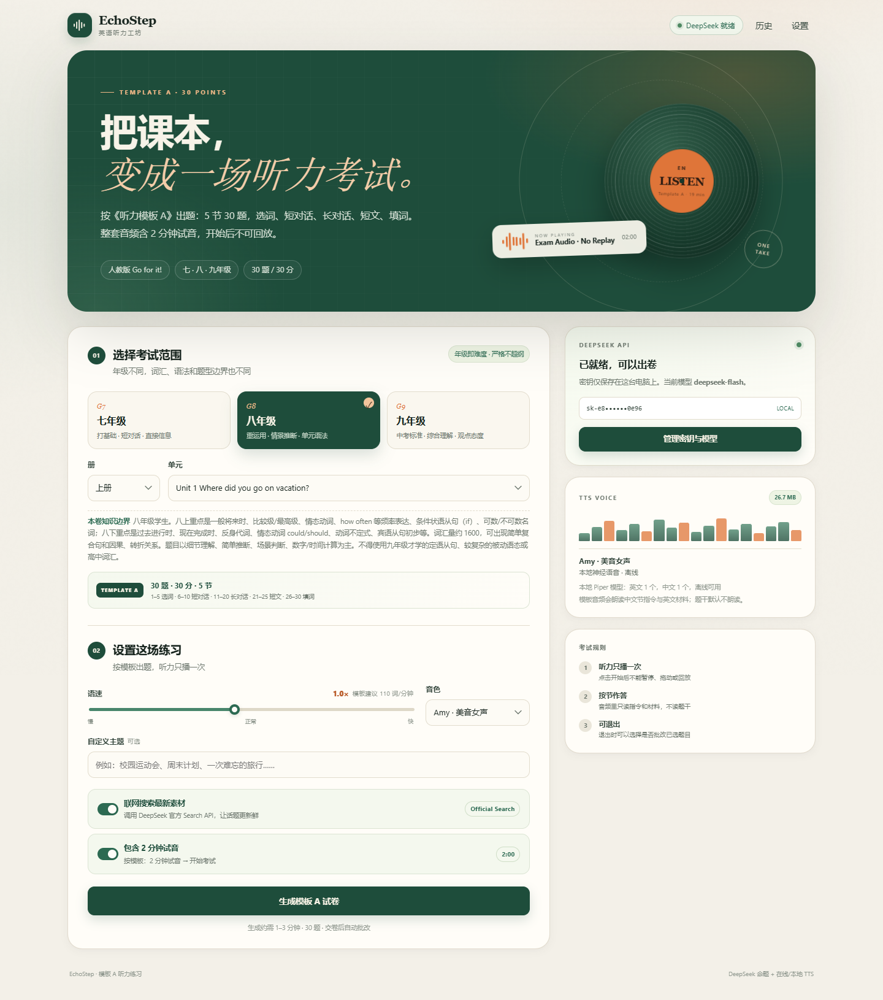

# EchoStep Windows 版 · 初中英语听力练习

Windows 桌面版：填入 DeepSeek API Key，选择年级/册/单元，AI 按《听力模板 A》自主出 30 题、5 节的听力卷；本地 TTS 朗读；交卷自动批改，显示分数、解析和原文。

> 本目录：`D:\dsh-work\English\windows`。Android 版见 [`EchoStep-Android`](https://github.com/quiet-grove/EchoStep-Android)。
>
> 出题模板：[`听力模板.md`](听力模板.md)；录音格式：[`听力原文模板.md`](听力原文模板.md)。



## 模板 A 结构

| 节 | 题号 | 题型 | 分值 |
| --- | --- | --- | --- |
| 第一节 | 1–5 | 听句子，从 3 个发音相近的词中选出句子里出现的那个（辨音选词，代替图片） | 5 |
| 第二节 | 6–10 | 5 段短对话，每段 1 题，3 个选项 | 5 |
| 第三节 | 11–20 | 3 段长对话，共 10 题，3 个选项 | 10 |
| 第四节 | 21–25 | 1 篇短文，5 题，3 个选项 | 5 |
| 第五节 | 26–30 | 1 篇短文 + 信息表，5 个填词，短文读三遍，每空 1 个单词/数字/时间 | 5 |

总分 **30 分**，题量固定 **30 题**。选图题改成“听句子，从 3 个易混词中选出听到的词”，不需要图片素材。

七、八年级单元目录按 [`unit.md`](unit.md) 的 **2024 版 PEP 新教材**整理；九年级仍为人教版全一册。

出题难度直接使用 **“七年级PEP版英语 / 八年级PEP版英语 / 九年级PEP版英语”** 作为难度标签。考试范围除各单元、综合复习外，新增 **“期中考试（前半册）”**，只考前一半单元。

## 听力格式与规则

按《听力原文模板》生成一条完整音频：

```text
英文麦克风试音
→ 听力考试开始
→ 第 1 节指令 → 第 1–5 题（先读题号，再读句子两遍，每题停 5 秒）
→ 第 2 节指令 → 第 6–10 题（先读题号，再读对话两遍，每题停 5 秒）
→ 第 3 节指令 → 3 段长对话（各读两遍，每题停 8 秒）
→ 第 4 节指令 → 第 21–25 题 → 短文（读两遍，停 30 秒）
→ 第 5 节指令 → 第 26–30 题 → 短文（读三遍，停 30 秒）
→ 听力考试结束
```

- **不朗读题干和选项**，只读中文节指令和英文材料，和真实听力考试一致。
- **听力一旦开始，不能暂停、拖动、回放**；播放器会锁住。
- 中途可以 **退出考试**：退出时选择“批改已选题目并退出”或“直接退出”；空题按答错算。
- 只有启动时加 `--debug` 才允许拖动进度条、暂停和回放。调试模式只影响播放，不影响出题。

### 开启 debug

```bat
run.bat --debug
```

或：

```bat
.venv\Scripts\python.exe app.py --debug
```

右上角会出现红色 **DEBUG** 标记。正式练习直接双击 `run.bat` 即可。

## 桌面窗口版

`run.bat` 默认打开 **原生桌面窗口**（pywebview/WebView2），不再默认弹出浏览器。窗口内可以正常使用全部页面功能，右上角有 **“浏览器打开”** 按钮；也可以：

```bat
run.bat --browser
```

直接用默认浏览器打开。`desktop.py` 是窗口入口；`app.py` 仍可作为纯服务器运行（`python app.py --browser` 才打开浏览器）。

打包好的免 Python 环境版本在 [Releases](https://github.com/quiet-grove/EchoStep-Windows/releases/latest)（`EchoStep-Windows-1.0.zip`，解压后运行 `EchoStep.exe`）。

## 快速开始

双击 **`run.bat`**。首次运行会自动创建 `.venv`、安装依赖；模型已随目录准备好。启动后打开：

```text
http://127.0.0.1:8765
```

1. 右上角 **设置** → 填 DeepSeek API Key → 测试连接 → 保存。
2. 选择年级、册、单元（可选填主题）。
3. 点 **生成模板 A 试卷**。
4. 进入试卷后等整套音频准备好，点播放开始考试。
5. 交卷，或退出时选择批改已选题目。

也可以手动启动：

```bat
.venv\Scripts\python.exe app.py
.venv\Scripts\python.exe app.py --port 9000
.venv\Scripts\python.exe app.py --debug
```

## 音频与语音

| 引擎 | 联网 | 体积 | 说明 |
| --- | --- | --- | --- |
| **Piper（默认）** | 否 | 26.7 MB | 英文 `en_US-amy-low` + 中文 `zh_CN-huayan-x_low`；**纯 CPU 推理**；完整支持模板停顿 |
| Edge TTS | 是 | 0 | 微软神经网络语音 Ava，中英双语；Edge 接口不支持任意插入静音，停顿会比模板紧一些，建议正式考试用 Piper/SAPI |
| Windows SAPI | 否 | 0 | 系统语音，合成快；支持停顿；不同电脑音色不同 |

- 试音是固定英文麦克风测试，不再插入 2 分钟静音。

- 整套音频较长，首次生成需要较长时间；生成后按内容哈希缓存，第二次直接播放。
- 音频在 `output/audio/`；可在设置里清除缓存。
- 模板默认 **不朗读题干**，所以设置里不再提供“朗读题干/选项”开关。

## 评分

- 选择题：A/B/C 比对答案（第一节也是三选一辨音）。
- 填词题：忽略大小写和首尾空格，按拼写批改；每空可填单词、数字或时间。
- 交卷后显示 30 题逐题对错、正确答案、中文解析和每段听力原文。
- 退出并批改时，只批改已选题目，未答按错算；结果页会标注“已退出”。

## 目录

```text
windows/
├─ app.py                     # HTTP 服务、出卷/批改/音频接口
├─ run.bat                    # 双击启动
├─ setup.bat                  # 首次安装/修复环境
├─ listening_app/
│  ├─ prompts.py              # 模板 A 命题 Prompt
│  ├─ schema.py               # 30 题结构校验、公开版、填词批改
│  ├─ tts.py                  # 模板音频脚本 + Piper/Edge/SAPI
│  ├─ deepseek.py             # Chat Completions + 官方 Search API
│  ├─ units.py                # 人教版单元与年级知识边界
│  ├─ config.py               # 配置、Key 掩码
│  └─ storage.py              # 试卷持久化
├─ web/                       # 原生 HTML/CSS/JS，无前端构建
├─ models/piper/              # 26.7 MB 中英文本地语音
├─ tools/                     # Piper 音色安装、SAPI 脚本
├─ data/                      # 配置 + 历史试卷
├─ output/audio/              # 音频缓存
├─ tests/                     # 单元测试 + 模拟 API 集成测试
├─ screenshots/
└─ requirements.txt
```

## 测试

```bat
.venv\Scripts\python.exe -m unittest discover -s tests -v
```

当前 **35 个测试**覆盖：

- 模板 A 的 5 节/30 题结构、第一节 3 个易混词、其余 3 个选项、5 个填词；
- 纯英文材料校验、题号连续性、信息表题号一致性；
- 公开版不泄露答案/解析/原文；
- 选择题和填词题批改（大小写、空格、空题）；
- 模板音频脚本：英文麦克风试音、材料读两遍（第五节三遍）、长对话 8 秒/题、短文 30 秒、不读题干；
- DeepSeek 模拟服务器的搜索 → 出卷 → 批改链路；
- `--debug` 状态。

前端另用 Playwright 验证了：30 个答题卡、辨音/填词交互、音频开始后锁定、重新打开同一试卷仍锁定、`--debug` 可拖动和回放。

## 安全与限制

- API Key 明文保存在 `data/config.json`，不要把这个文件发给别人，也不要提交到 Git。
- 仅本机监听 `127.0.0.1`；如需局域网访问，自行加 `--host 0.0.0.0` 并注意密钥安全。
- Edge TTS 是微软公开但非官方接口，可能随策略变化；正式商用请用 Azure Speech 等有 SLA 的服务。
- 音频长度约 19–21 分钟，Piper 本地首次合成会比较慢；建议生成后等待缓存完成，或改用 SAPI。
- AI 会校验结构、纯英文材料、3 个选项、填词答案、期中范围等；仍建议对高质量要求高的试卷人工抽查。
- 目前只内置人教版 Go for it! 单元；其他教材可用“综合复习”+ 自定义主题，或扩展 `listening_app/units.py`。

## Android 版本

Android 版在 [`EchoStep-Android`](https://github.com/quiet-grove/EchoStep-Android)，已同步模板 A，并集成 Edge 优先 / ncnn 本地兜底。

## 参考

- [DeepSeek API 文档](https://api-docs.deepseek.com/)
- [DeepSeek 网页搜索与抓取指南](https://api-docs.deepseek.com/zh-cn/guides/search)
- [Piper](https://github.com/rhasspy/piper)
- [Piper voices](https://huggingface.co/rhasspy/piper-voices)
